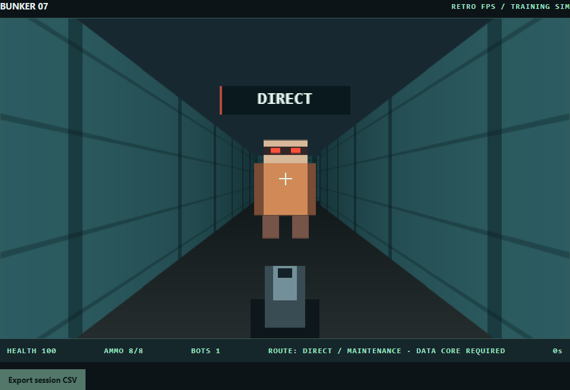
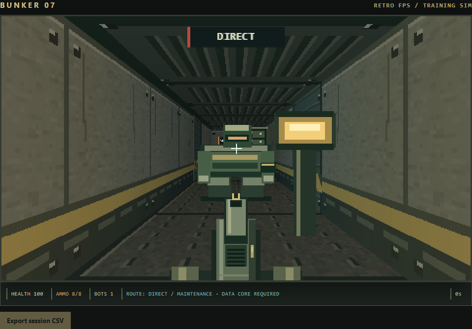
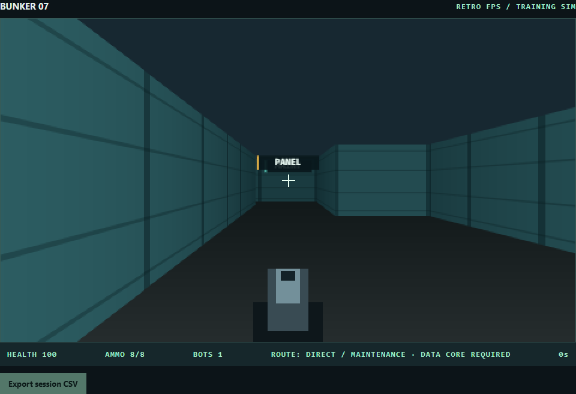
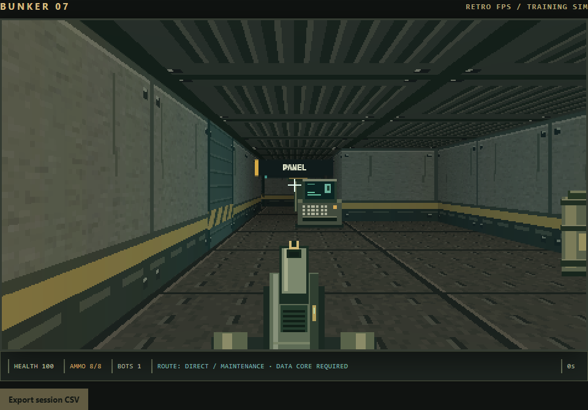

# Control Room visual upgrade

Implemented on `feature/control-room-atmosphere`. Existing uncommitted campaign, audio and menu work was retained. Research, original asset creation and code review were delegated independently; the main agent alone integrated renderer changes.

## Diagnosis and direction

The baseline used flat teal wall bands, a screen-space floor gradient, a solid ceiling, static rectangle bots, a block weapon and plain text statuses. These provided little material scale, environmental function or animation feedback.

The new direction is a worn civil-defense control bunker: gray-olive concrete, charcoal steel, ochre safety bands, ribbed ceiling panels, bolted floor plates, amber service fixtures and cyan terminals. Original consoles, equipment racks, drums and lamps establish function. A detailed weapon and gloves share the material palette, with existing recoil/reload motion plus movement sway. Bots have idle, actual-movement and attack-anticipation frames. HUD spacing, borders and color separate health, ammunition and objectives without removing existing text cues.

## Applied source techniques

See [direct source research](research.md) for links and rationale.

- Lode I: fractional intersection texture columns, mirrored faces, perpendicular projection and directional wall shading.
- Lode II: world-position floor/ceiling samples on horizontal scanlines before walls, distance fading, and half-pixel horizon sampling to avoid division by zero. This implementation computes each sample directly rather than using Lode's incremental row optimization.
- Lode III: far-to-near transparent billboards with per-column wall depth clipping. Route signs now use this clipping too, replacing their old center-only test.
- The Level Design Book, Encounter: retained the sheltered route-choice space, direct threat and maintenance bypass; made route signs persist and decorated the panel/core spaces without blocking the route. The existing guard warning, reinforcement, panel, core and extraction sequence remains intact. Attack animation adds anticipation to the existing damage timer.
- The Level Design Book, Lighting: ambient material shading plus world-space falloff directs attention toward panel/core areas. Amber fixture shading differentiates the direct corridor from the cyan maintenance panel; the amber area becomes red during an alarm. Visible emissive pixels belong to depth-clipped fixtures. Lighting is deliberately restrained to preserve silhouettes and warning text.

## Renderer constraints identified before implementation

Canvas 2D, 480×270, single-height opaque grid walls, planar floors/ceilings and one wall depth value per screen column. No arbitrary meshes, elevation, real shadow casting or reflection system. Consequently, pipes/panels are texture detail, props are flat camera-facing sprites, and local light is analytic surface shading. Props are decorative and nonblocking; they do not create cover or affect line of sight. Transparent overlap uses painter sorting, which has the usual intersecting-billboard limitations. No shadow or bloom capability is claimed.

Original procedural art has [documented provenance](assets.md); no external visual assets were used.

## Verification

`npm install` then `npm test` runs the Playwright browser harness. It uses installed Windows Chrome at the explicit path in `tests/playtest.cjs`; adjust that path for another system. The game itself still runs directly from `index.html` without dependencies or a build.

Latest [machine-readable results](playtest-results.json): 41 checks passed, no JavaScript page errors. Coverage includes both collision-based routes through extraction, interrupted detection, alarm activation, exactly one reinforcement, panel prevention/silencing, core gating, shooting, attack windup/damage, keyboard reload, pause UI, and rendering all three missions. Most gameplay checks advance the actual game update functions deterministically; reload and pause also use browser keyboard input. This is automated browser playtesting, not a claim of a complete human mouse/pointer-lock campaign playthrough.

Screenshots were visually inspected at identical camera positions. Texture perspective, bot silhouette, prop placement, weapon visibility and HUD legibility were checked. Sprite/sign clipping was independently reviewed against the per-column wall-depth path. Average render time was approximately 8 ms across 30 render calls in headless Chrome on this machine; this is not a cross-device frame-rate guarantee.

Review fixes: clamped lighting alpha to prevent invalid Canvas colors, disabled main-context image smoothing, tied walk frames to real movement, and removed the unreachable rectangle-bot drawing path. The global attack warning remains above the scene; the old per-bot badge was replaced by the attack pose.

Unverified: other browsers/devices, pointer-lock behavior during a full manual campaign, and long-session performance. Existing mouse capture and analytics behavior were retained; the expanded pre-push review additionally verified CSV download, settings persistence/reset, storage/audio fallback, retry/progression, tutorial state, and delayed pointer capture.

## Before and after

Guard approach, same camera:

Maintenance approach, same camera:

`tests/fixtures/before.html` preserves the starting renderer for reproducible comparison screenshots.
