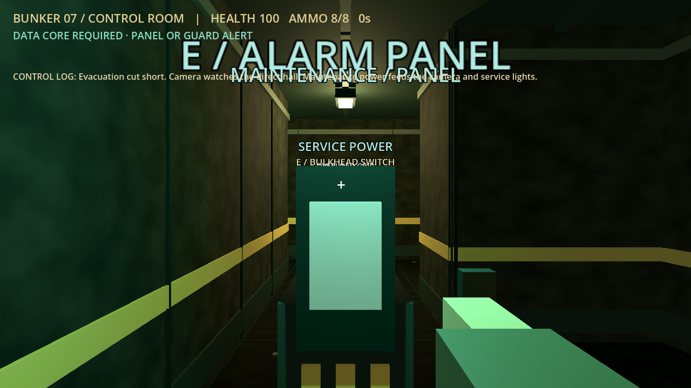
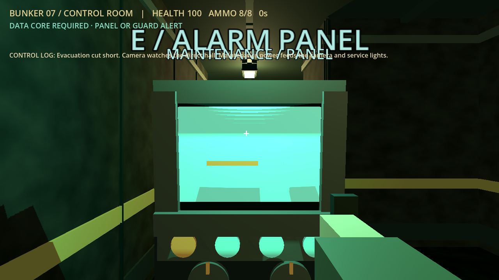
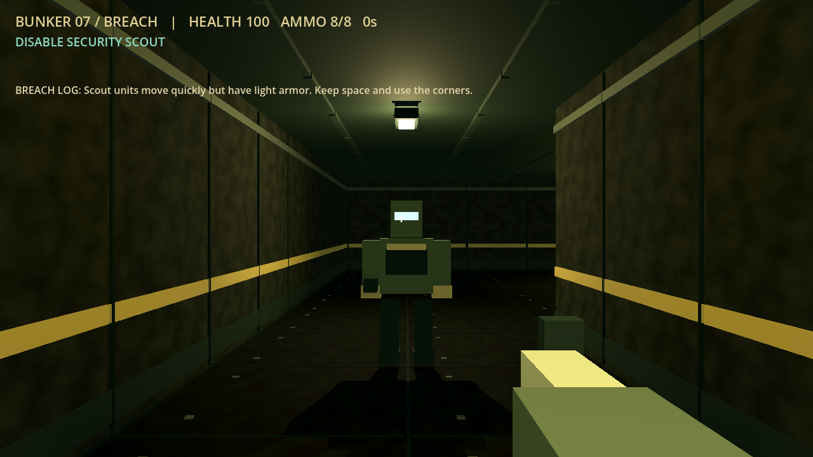
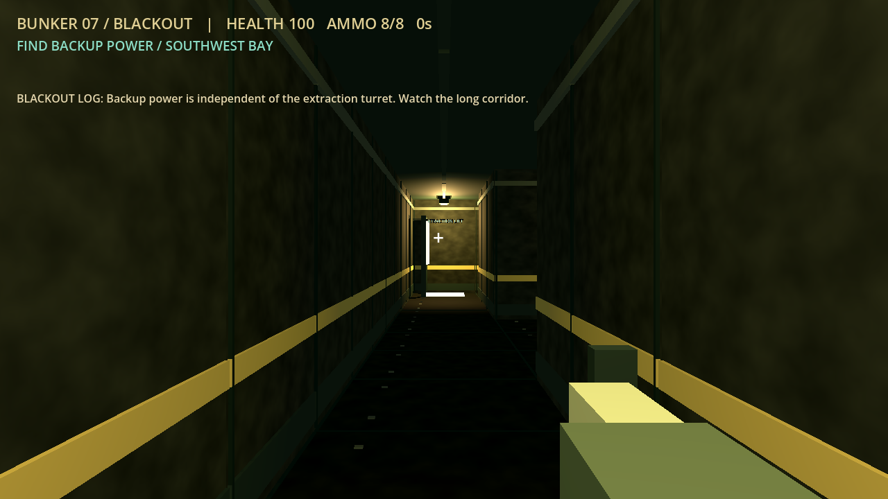
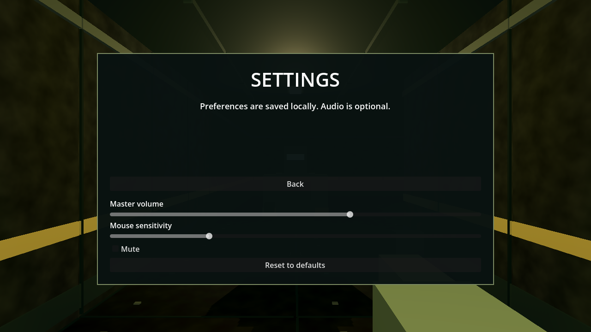
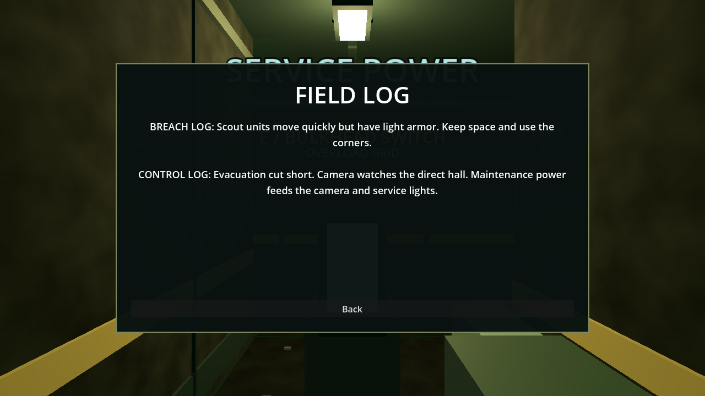
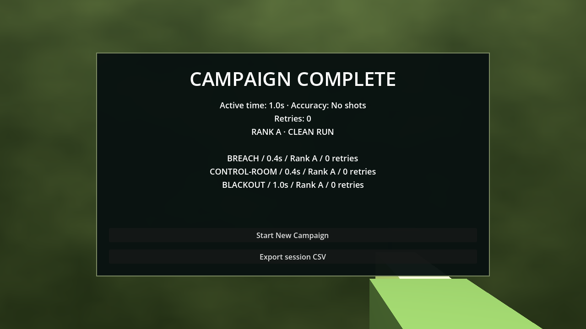

# Native campaign release candidate

The native campaign was merged to `main` and pushed to `origin/main` in commit `f72c9b5` (based on `af85238`). This document records the validation for that merged release candidate; the hosted browser game remains unchanged.

The native game includes Breach, Control Room and Blackout, their reference maps/objectives, all three enemy roles, reactive security and devices, optional rewards, successful-extraction-only consequences, retries/ranks/journal, menus/settings/onboarding, summaries and CSV. [Parity and limits](parity.md) and [launch instructions](../../godot/README.md) are current. Earlier checkpoint/M1 reports remain historical evidence.

## Final validation

Tested with installed `4.7.2.stable.official.ed1daf0bf`, GDScript and Compatibility rendering on Windows. Actual executed checks:

- Godot editor import/parser validation: exit 0, no script/import errors.
- Native M1 mechanic regression: **46 passed**, zero failed. This retains movement, aim, hit tolerance, occlusion, reload/attack pause, guard detection/chase, panel range, core gate, traversal and retry coverage. New shootable fixtures are explicitly disabled in old guard-only scenarios; the campaign suite tests their actual hit ordering separately.
- Independent campaign suite: **51 passed**, zero failed, exit 0. Covers all three collision-driven routes, progression, devices, role combat, camera/pause/LOS, optional objectives, failure/success commits and Blackout consequences, ranks, settings/persistence, onboarding, journal and real CSV export/escaping/counters.
- Active-audio window-close smoke: exit 0, no ObjectDB warnings. Also independently executed by the reviewer.
- Graphical campaign smoke: exit 0, no runtime errors. Three native worlds, settings, journal, Blackout power interaction and final summary were captured and visually inspected. Scene transitions used for screenshots are scripted; displayed subsecond result times are not human gameplay records.
- Browser source/tests/styles/entry-page diff against pre-port `af85238`: empty. The earlier fresh browser baseline remains separately recorded in [browser-baseline.json](browser-baseline.json); it is not presented as a fresh browser rerun in this finalization pass.

Saved native results are in `godot/tests/milestone-results.json` and `godot/tests/campaign-results.json`. Run commands are in the native README. Import exit status alone is insufficient: output was also inspected for errors. No remaining blocking defect was found within this coverage. Full human mouse-driven campaign, subjective audio balance, other platforms/drivers, exports and prolonged performance testing remain unverified.

## Review fixes and cleanup diagnosis

Independent review found and verified fixes for active-play settings not pausing, CSV targets packed into detail, and enemy-disable events observing a stale hit counter. Rendered inspection also removed duplicate mission journal entries and aligned visible turret aiming with its target.

Verbose cleanup diagnostics identified only `AudioStreamPlaybackWAV` and associated `AudioStreamWAV` resources when a test terminated immediately after deleting its scene. Explicit shutdown now stops voices, detaches their streams and clears the audio cache. The harness and actual game-window close path allow 150ms for asynchronous mixer releases before terminating. The final verbose mechanic run and active-sound close test both exit without the previous ObjectDB warning. This is a validated cleanup fix on the tested engine/platform, not a cross-platform lifetime guarantee.

Related engine reports describe the same category of exit-while-playing warnings: [Godot #76745](https://github.com/godotengine/godot/issues/76745), [Godot #95484](https://github.com/godotengine/godot/issues/95484). Those reports informed the hypothesis; our own stop/detach/drain comparison established the fix for this project. Manual quit handling uses the documented [SceneTree auto_accept_quit](https://docs.godotengine.org/en/stable/classes/class_scenetree.html#class-scenetree-property-auto-accept-quit) behavior.

All 3D meshes, textures, effects and synthesized audio are original project source; no external art or recordings were downloaded. Godot's built-in font is used.

## Visual evidence

The Control Room alarm console comparison uses the same camera position and scene state:

## Control Room console cleanup

Matched Compatibility-renderer captures show the alarm console before and after the visual cleanup at a normal 3 m approach and the 1.6 m interaction boundary. Each distance is shown with the alarm active and after silencing it. The HUD retains the `E · USE PANEL` prompt inside interaction range.

| View | Before | After |
| --- | --- | --- |
| Normal approach, alarm active | [Screenshot](campaign-screenshots/console-cleanup-before-approach-active.png) | [Screenshot](campaign-screenshots/console-cleanup-after-approach-active.png) |
| Interaction range, alarm active | [Screenshot](campaign-screenshots/console-cleanup-before-interaction-active.png) | [Screenshot](campaign-screenshots/console-cleanup-after-interaction-active.png) |
| Normal approach, silenced | [Screenshot](campaign-screenshots/console-cleanup-before-approach-silenced.png) | [Screenshot](campaign-screenshots/console-cleanup-after-approach-silenced.png) |
| Interaction range, silenced | [Screenshot](campaign-screenshots/console-cleanup-before-interaction-silenced.png) | [Screenshot](campaign-screenshots/console-cleanup-after-interaction-silenced.png) |
