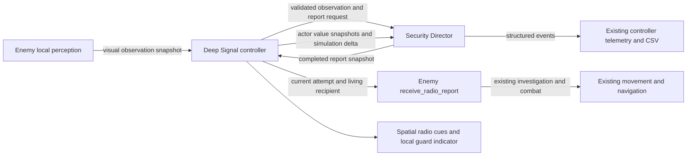

# GHOST PROTOCOL: implemented architecture

Phase 2 adds delayed, interruptible radio for the authored SECURITY pair to the preserved Phase 1 evidence store. Full data contracts, before/after behavior, encounter fixtures, validation results and open browser gate are in [radio implementation](ghost-protocol-radio.md). The [Phase 0 baseline](ghost-protocol-baseline.md) remains the historical behavior reference.

## Ownership and event flow



- **Director:** mission-owned `RefCounted`, observations, bounded report queue, original provenance/deadlines, delivery/expiry/dedup and deterministic ordering. It cannot query the player or retain actor references.
- **Mission:** Deep Signal-only ownership, stable actor ID lookup, pair/range authorization, alive/stagger/membership snapshots, attempt identity, once-per-tick advancement, signal routing, cues and cleanup. Iron Relay's shared mission ID is not used as the activation gate.
- **Enemy:** local perception and last-known evidence, reaction, firing/reload, movement/cover/navigation and stuck recovery. It reports actual sighting IDs and receives historical messages intentionally, without routing radio through shot hearing.
- **Level:** unchanged authored solids, cover points and `tactical_path`. No new director path queries or destinations exist.
- **Player:** unchanged movement/weapons and existing one-event-per-shot hearing broadcast. Damage itself no longer reveals camera position.

## Preserved observation surface

```gdscript
func initialize_for_mission(mission_id: String, attempt_id: int = 0) -> void
func get_simulation_time() -> float
func get_mission_id() -> String
func advance(delta: float) -> void
func record_observation(observer_id: String, kind: String, position: Vector3,
    confidence: float, ttl_seconds: float, sector_id: String = "",
    metadata: Dictionary = {}) -> int
func get_active_observations() -> Array[Dictionary]
func get_observations_for(observer_id: String) -> Array[Dictionary]
func clear() -> void
```

One-argument initialization remains supported. Invalid record inputs return 0 without consuming IDs or emitting events. Valid kinds remain `visual_contact`, `sound_contact`, `visual_lost`. Positions/confidence/TTL must be finite, confidence 0..1 and TTL strictly positive with a representable future deadline. Observer/sector/mission strings and flat scalar metadata retain Phase 1 limits. Metadata and queries are detached. Storage stays at 128 observations with oldest-insertion eviction. Visual contact records acquisition/one-second refresh; sight loss records the last genuinely observed point; sound stays distance-limited. Nonvisual events cannot become radio sightings.

## Radio API and policy

```gdscript
func sync_radio_actors(actors: Dictionary) -> void
func queue_radio_report(sender_id: String, observation_id: int,
    recipient_ids: Array, delay_seconds: float) -> int
func cancel_radio_report(report_id: int, reason: String) -> bool
func cancel_reports_from(sender_id: String, reason: String) -> void
func get_pending_radio_reports() -> Array[Dictionary]
func get_radio_report(report_id: int) -> Dictionary
func get_radio_history() -> Array[Dictionary]
func get_delivered_knowledge_for(recipient_id: String) -> Array[Dictionary]
func get_attempt_id() -> int
signal radio_report_changed(report: Dictionary)
signal radio_report_delivered(recipient_id: String, report: Dictionary)
```

Reports retain source observation ID/observer/position/time/confidence/expiry, actual sender, sorted intended/delivered recipients, submission/completion time, status/cancellation reason and mission/attempt identity. IDs increment per attempt; `(attempt_id,id)` is the report identity. Forwarding is unsupported. Queue rejection returns 0; repeated cancellation returns false. There are at most 16 pending reports (one per sender), 64 terminal records and 32 active delivered records per recipient. Source-linked dedup persists beyond delivered-history eviction while the source remains queueable. Queries are detached and all records are value-only.

Production registers only `security-smg` and `security-rifle`; each may reach its partner within 12m at submission/delivery. Transmission takes 1.4 simulation seconds, with the existing two-second attempt throttle. Original provenance and expiry are never rejuvenated. Current local evidence wins if newer/equal-time or strictly more confident while active. Accepted radio sets only historical memory and existing suspicious/search execution; local LOS and firing checks stay authoritative.

## Timing and lifecycle

The controller advances once after processing current player actions, under active/unpaused guards. This lets a queued hit interrupt before same-tick completion. Current actor membership/life/stagger/positions are synchronized before delivery; the controller revalidates actual nodes again in the completion callback. Dead, removed, queued-for-deletion, self, duplicate and out-of-range recipients cannot learn anything. A hit's actual stagger or death cancels immediately; animation/reload alone does not. Losing sight preserves the valid in-flight snapshot.

All time is explicit simulation seconds. Expired evidence cancels in-flight reports; expiry equals the original source deadline, never delivery time plus TTL. Reports resolve in report-ID insertion order and recipients in lexical order. Replay guarantees equal ordered events/deltas on the same engine; cross-platform physics determinism is not claimed. No independent timer, wall clock or RNG was introduced.

Existing cleanup covers retry, mission load/briefing, title/abandon, win/loss, scene change, quit and destruction. Radio signals disconnect before clearing, local indicators turn off, pending reports cancel for telemetry, and all evidence/history/actor snapshots/dedup/attempt IDs reset. Old instances are inactive; stale delivered snapshots fail the actor's current-attempt check. Pause, journal and settings freeze the director without discarding the attempt.

## Presentation and telemetry

Existing `register_event`/CSV columns carry versioned JSON detail; observation and radio IDs are scoped by the existing run plus explicit attempt. New `security_radio_started/delivered/cancelled` events retain provenance and deadlines. There is no per-frame radio logging or competing log system. Session log retention is unchanged.

Three short, cached synthesized spatial chirps and a depth-tested cyan chest light/RADIO label make the transmission local and interruptible. Mute affects playback only. No voice assets, libraries, global guard-location message or permanent HUD were added. Audio/visual test status and the explicitly unverified audible mix are recorded in the radio report.

## Phase 3 boundary

No tactical roles, search reservations, generated destinations, flanking, reinforcement waves, forwarded reports or sector alert framework exist. Future shared-knowledge consumers must retain observation provenance/deadlines, ask the existing level for reachable paths, and leave enemy combat/navigation local. Only expand partnerships or coordination after the open browser/audio/human playtest gate and performance review. Any future randomized decisions need an isolated seeded RNG and stable candidate ordering; current radio needs none.
