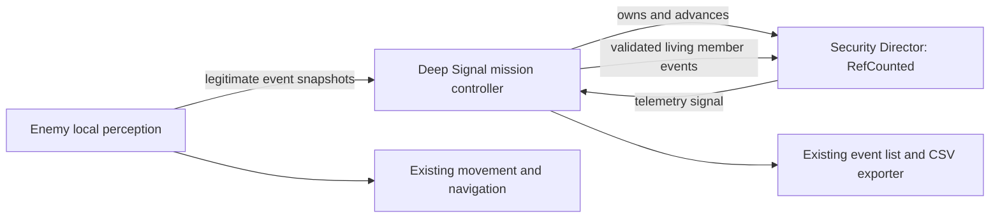

# GHOST PROTOCOL: architecture

Phase 1 implements passive evidence recording only. It does not provide intelligent coordination or change enemy knowledge/decisions. The [Phase 0 baseline](ghost-protocol-baseline.md) remains the historical behavior reference; [verification](ghost-protocol-test-plan.md) records current coverage.

## Implemented ownership and event flow



`godot/scripts/security_director.gd` extends `RefCounted`, has no independent processing, player reference, actor reference, geometry query or decision output. This replaces the Phase 0 proposed Node: an explicit controller-owned clock supplies the required pause/lifecycle guarantees without another scene-tree processor. No global singleton, dependencies, renderer, networking or random decisions are introduced.

`campaign_main.gd::start_run` creates one recorder only when `operation_mode` is true. Original campaign and Iron Relay never set that flag for their active gameplay. Both operations use mission ID `tactical-operation`, so mission ID alone is deliberately not the gate. Recording is enabled for Deep Signal without an opt-in flag because it is entirely passive.

Initialization follows actor/room/player/system/pickup setup and the attempt counter increment, before `active=true`. Existing enemy `setup/reset_guard` emits no perception events; setup awaits readiness only when necessary, and registration-free hooks cannot record until the controller is active and the actor is a living member of `enemies`. No deferred director callbacks exist.

`campaign_main.gd::_physics_process` advances the director exactly once using the same delta as `elapsed`, after its existing active/unpaused guard. Enemy hooks execute later as child physics callbacks. The director has no independent wall clock or timer. Equal ordered input/update sequences yield equal IDs, timestamps, expiry and eviction. Float seconds accumulate in supplied update order; differently partitioned deltas and cross-platform physics are not promised bit-identical. Integer scheduling and canonical ordering for future coordination remain deferred.

## Implemented API and validation

```gdscript
signal telemetry_event(event: String, detail: Dictionary)
func initialize_for_mission(mission_id: String) -> void
func get_simulation_time() -> float
func get_mission_id() -> String
func advance(delta: float) -> void
func record_observation(observer_id: String, kind: String, position: Vector3,
    confidence: float, ttl_seconds: float, sector_id: String = "",
    metadata: Dictionary = {}) -> int
func get_active_observations() -> Array[Dictionary]
func get_observations_for(observer_id: String) -> Array[Dictionary]
func clear() -> void
```

Successful recording returns a positive incrementing ID, starting at 1 per initialization. Invalid input returns **0**, consumes no ID, changes no stored evidence and emits no telemetry. Initialization clears existing state; empty/whitespace or >96-character mission IDs leave the recorder inactive. Recording without initialization is rejected. Observer ID must be nonblank and <=96 characters; the controller validates current living membership. The pure store does not discover or retain actors.

| Observation field | Implemented contract |
| --- | --- |
| `id` | Incrementing integer within the attempt; combine existing telemetry `run` with ID for session identity |
| `observer_id` | Authored enemy ID, copied as a string |
| `kind` | Exactly `visual_contact`, `sound_contact` or `visual_lost` |
| `position` | Finite Vector3 world meters, snapshot only |
| `confidence` | Finite inclusive 0..1; invalid values rejected, never clamped |
| `created_at` | Director simulation seconds at recording |
| `expires_at` | `created_at + ttl_seconds`; TTL must be finite and strictly positive, with finite sum strictly greater than creation time |
| `sector_id` | Optional string, <=96 characters; empty is used by current hooks (no invented sectors) |
| `metadata` | Optional flat dictionary, <=8 entries; String keys <=64 characters; values null/bool/int/finite float/String <=128 characters. Objects and nested containers rejected |

Metadata input and query results are copied; mutations cannot change stored records. Queries return detached dictionaries in insertion order. `advance` ignores nonfinite, negative, zero or overflowing deltas. At `expires_at <= simulation_time` records are removed before subsequent queries. Storage holds at most 128 observations; a valid insertion at capacity evicts the oldest inserted record, regardless of expiry order. Every physics update scans at most 128 records without allocating a history copy. Strings, metadata and active storage are bounded; existing session telemetry retention remains session-long, as before.

## Implemented passive hooks

`deep_signal_enemy.gd::_observe_visibility` receives the result of the existing `can_see_player` call; it adds no LOS queries or threshold changes. It records visual contact on acquisition and at most once per second while continuously visible. It remembers the latest legitimately visible camera point for loss telemetry. A falling visibility edge records `visual_lost` once at that old point, never the now-hidden camera or ally-updated memory. Visual events have confidence 1 and TTL 8s; these are logging attributes, not AI tuning. The `visual_lost` confidence confirms the visibility transition, not certainty about current player whereabouts.

`hear_shot` records an accepted local sound snapshot after the existing alive/range check, even if engagement means the AI ignores investigation. Sound confidence is .6 and TTL 7s. Existing `campaign_main.gd::shoot` broadcasts once per shot, not per pellet, and muting audio does not change hearing. No movement noise is invented. Repeated legitimate gunshots are distinct events; there is no per-frame sound sampling.

The legacy `shared=true` path still instantly shares sightings and changes memory exactly as before, but produces no `sound_contact`. `receive_hit` still reads the live hidden camera and calls `hear_shot`; its added third argument `record_sound=false` suppresses only passive evidence for that non-acoustic shortcut. No hit reaction, memory, hearing radius, communication timing or combat/navigation decision is corrected here. These exclusions prevent future consumers mistaking legacy shortcuts for legitimate observations.

## Reset and teardown

`_clear_security_director` calls `clear`, disconnects the telemetry adapter and releases the controller reference. It is idempotent. It is invoked at start/reload, briefing, title/abandon, finish (win or loss), Iron Relay scene launch, orderly quit and `_exit_tree`. Retry clears the old instance and creates a new one; externally retained old instances are empty, inactive and disconnected. `clear` resets mission ID, clock, ID sequence and all evidence. Initialization/clear telemetry occurs once per actual initialized lifetime, not for redundant cleanup calls. Pause, journal and settings retain the recorder but freeze its clock and reject gameplay hooks.

Enemy death stops future hooks through existing alive guards and the controller membership check. Historical evidence remains until TTL, eviction or mission cleanup; observations contain values only, so evidence cannot keep a dead enemy alive. There is no enemy registration table or pending message queue yet.

## Telemetry

The director emits `security_director_initialized`, `security_observation`, `security_observation_expired` and `security_director_cleared` through a signal connected to `_on_security_telemetry`. The adapter calls existing `register_event` with JSON in `detail` and authored `observer_id` in `bot_id` where present. Existing CSV columns/escaping and web download path are unchanged.

All payloads carry `v:1`, `simulation_time` and `mission_id`. Observation payloads carry all observation fields, with position as a JSON numeric triple. Expiry carries `id`, `observer_id`, `kind` and `reason` (`ttl` or `capacity`); clear carries removed `count`. Existing row `run` disambiguates retry IDs. Initialization is logged after the attempt increment, and clearing is logged in the outgoing attempt. There are no per-frame events, permanent HUD or competing log files. Observations refresh once per second per seeing guard; each real heard shot and each removal emits an event. Longer missions can still grow the existing session log; measure this before expanding observability.

## Phase 2 boundary: planned, not implemented

Security Director will eventually own shared knowledge, confidence decay/uncertainty, delayed and interruptible reports, reachable search reservations, tactical roles and sector de-escalation. Enemy retains local perception, movement, collision, cover selection, weapons, damage and reload. Mission owns lifecycle, event integration and resolving living IDs. Level owns geometry/reachability; player/controller produces observable events.

Next changes should add report IDs, original observation provenance, attempt generation, recipient IDs, send/delivery ticks and cancellation reason; delayed delivery must never rejuvenate stale evidence. Replace the immediate ally loop only after delayed/interrupted/dead-sender acceptance tests exist. Replace the hidden-camera hit shortcut with damage evidence that has no fabricated source position. Add a narrow Deep Signal `tactical_path` callable only when assignments need reachability; do not combine Iron Relay's `find_path` geometry assumptions.

Future decision replay needs stable sorted actor/candidate ordering, a private seeded RNG isolated from ballistics and a generation guard for any asynchronous queue. Delivered knowledge must derive only from legitimate observation snapshots. Sound uncertainty and confidence aging require an explicit policy before these passive attributes can affect decisions. Flanking, assignments, alerts and reinforcements are absent in Phase 1. Do not treat this passive store as a radio or tactical planner.
