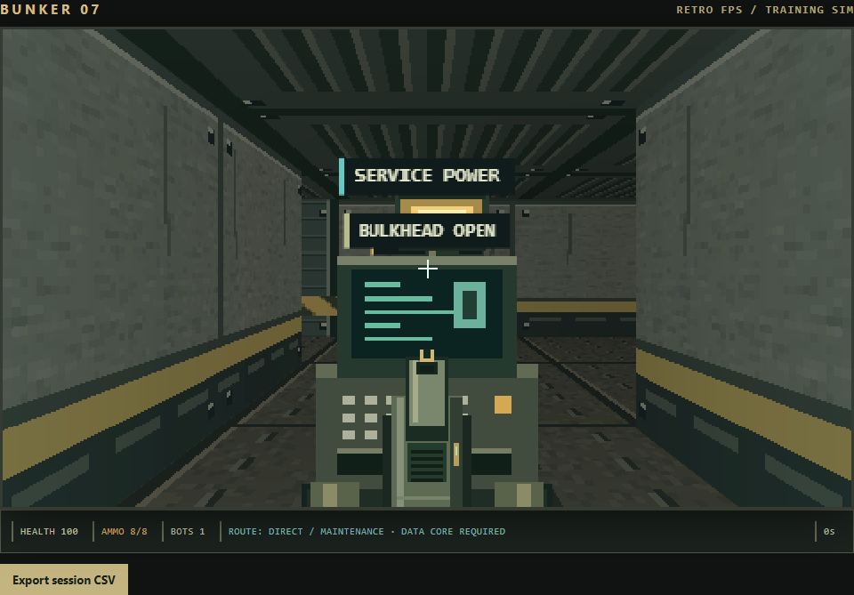
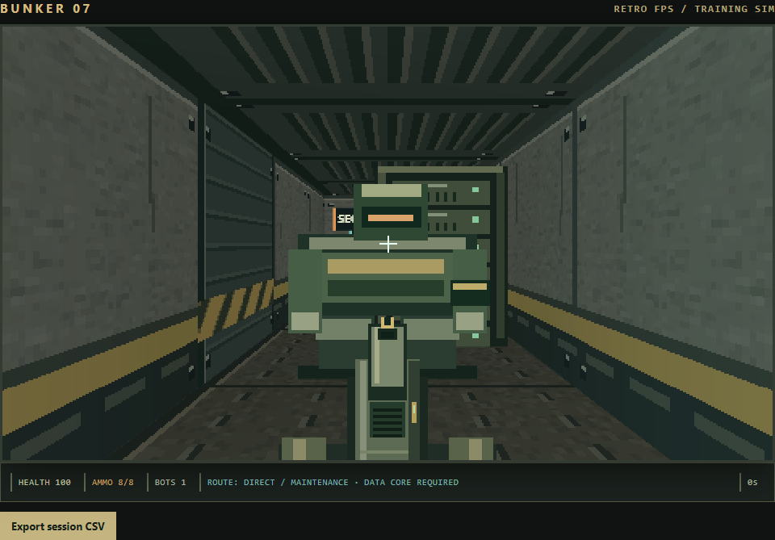
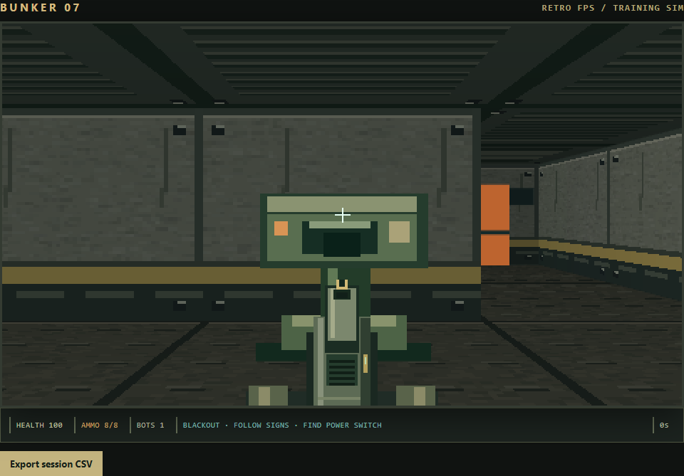
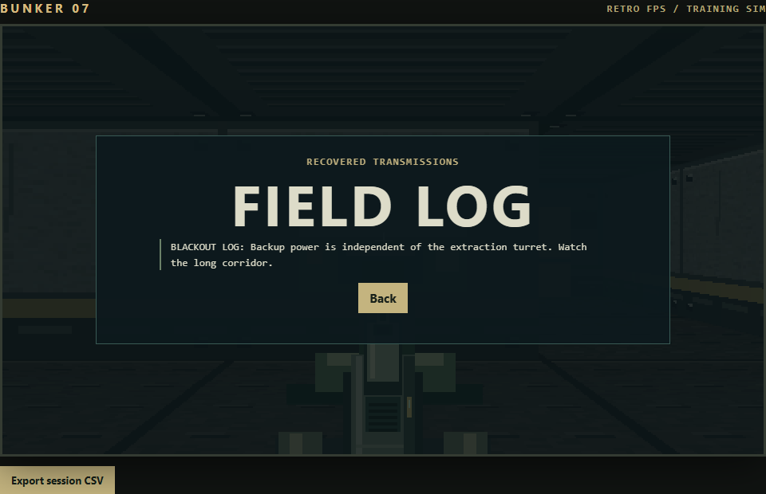

# Reactive bunker expansion

Implemented all seven proposed improvement areas, with Control Room as the main encounter. Work was developed on `feature/reactive-bunker` before review and integration into main.

| Area | Implemented behavior |
| --- | --- |
| Reactive security | Sweeping camera with a tracking warning and line-of-sight/cone checks; patrol guard that investigates gunshots and chases after an alarm; single scout reinforcement |
| Interactive equipment | Shootable camera and service lamp, reversible service-power isolation that trades light for surveillance shutdown, collision/visibility-aware bulkhead with obstruction protection, one-use grid overload |
| Combat feedback | Depth-clipped sparks and smoke, hit-marker feedback for devices and enemies, role-specific stagger poses, directional damage cue, spatial attack/detection/step/impact sounds |
| Enemy roles | Fast light scout, slow three-hit armored unit with stronger attacks, stationary ranged turret with an interruptible windup |
| Environmental storytelling | Damaged equipment, recovered evacuation manifest, medical-cache log, readable field journal and later intel clue |
| Campaign consequences | Successful quiet panel shutdown disables the later turret; successful alarm route adds an armored pursuit unit; retries preserve earlier committed decisions without committing failed optional finds |
| Replay goals | Optional risky intel, maintenance-cache alcove and supplies, and local result grades combining stealth, time, accuracy and optional finds |

The existing three-mission campaign and both Control Room routes remain playable. The overall map stays compact; the maintenance alcove is the only new room space. Controls now include J for the paused field log. Device instructions appear alongside the mission goal.

## Ownership and review

One main agent integrated renderer, UI and combat changes. Separate agents owned the encounter module and original art/audio; an independent reviewer authored the new browser tests and reviewed integration. Renderer changes batch depth-visible sprite stripes into clip rectangles while preserving wall occlusion, and share symmetric floor/ceiling samples with row-wise world-coordinate stepping. This reduced measured render time from approximately 20 ms during the expansion to approximately 10–11 ms in the final local headless Chrome measurement. This is a render-call sample, not a device-independent frame-rate guarantee.

Review caught and fixed device-hit feedback, mismatched prop names, status text hiding the mission goal, and a centrally placed lamp obscuring the armored guard. The lamp now sits beside the wall. Tactical device hits contribute to accuracy and hit markers. Stagger interrupts attack windups; turrets recheck line of sight before damage. The bulkhead uses the shared collision/raycast path and refuses to close on living actors.

## Verification and evidence

Final verification: **94 checks passed** (41 campaign checks and 53 independent encounter checks), with no JavaScript page errors. `git diff --check` passed.

Run `npm install` then `npm test`. The original campaign suite covers menus, settings, audio/storage fallback, export, combat and route traversal. The independent encounter suite covers device occlusion, camera line of sight, power tradeoff, door obstruction, overload, optional rewards, roles, consequences, ranks, journal UI and complete route traversal. Exact current results are in [campaign results](playtest-results.json), [encounter results](next-level-results.json), and [independent review](next-level-review.md).

These are real Chrome browser tests; many gameplay steps advance the real game update/collision functions deterministically. They are not a claim of a full manual mouse-driven campaign or cross-browser certification. Component audio checks also use a mock graph for cleanup and pan correctness; audible mix quality still benefits from human listening.

Screenshots were visually inspected for composition, silhouette, equipment placement and journal readability:

## Limits and assets

All new art and synthesized audio are original project source, with [provenance and component checks](feedback-assets.md). No external asset licenses are required. Lode and Level Design Book research from the prior pass remains in [research notes](research.md).

The raycaster remains single-height Canvas 2D with planar surfaces and camera-facing sprites. The bulkhead closes a complete grid tile instantly; it is not a sliding 3D door. Lighting is simulated surface shading, and positional sound uses stereo panning/distance attenuation without acoustic room simulation. Campaign consequences last for the current session/campaign; ranks are local result assessments. Stairs, multiple floor heights, real shadows, online rankings and a new renderer were not part of the seven gameplay improvements.
